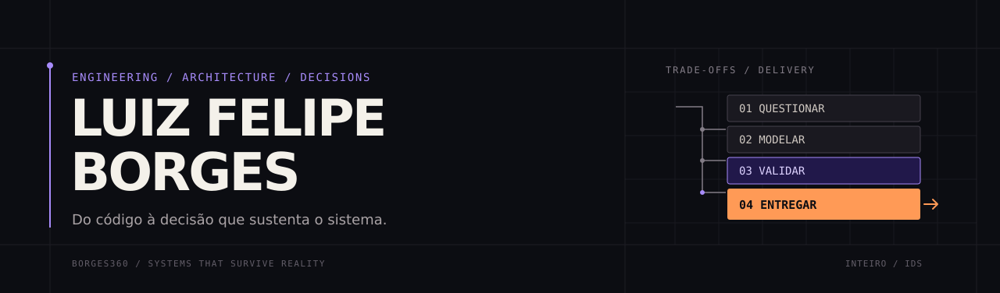

<!-- Perfil GitHub: colocar este README no repositório Borges360/Borges360. -->

# Luiz Felipe Borges

**Tech Lead · Engenharia de Software · Sistemas Distribuídos**  
São Paulo, Brasil

[LinkedIn](https://www.linkedin.com/in/luiz-felipe-borges/) · [INTEIRO / Identity Design System](https://github.com/Borges360/ids) · [Repositórios](https://github.com/Borges360?tab=repositories)

---

## Eu me interesso pelo que acontece depois do `merge`.

Uma API pode estar correta e ainda assim ser um problema. Quando a carga aumenta. Quando uma dependência falha. Quando o rollback é mais complexo que o deploy. Ou quando a equipe já não consegue explicar por que determinada decisão foi tomada.

É nessa interseção que eu trabalho: **código, arquitetura, operação e pessoas**.

Sou engenheiro de software e atuo como Tech Lead no Itaú Unibanco. Minha base está no backend e nos sistemas distribuídos, em ambientes nos quais latência, disponibilidade, consistência e rastreabilidade não são atributos opcionais.

Não tenho interesse em complexidade pela complexidade. Tenho interesse em **entender o suficiente para simplificar sem esconder o problema**.

## O que eu construo — e o que preciso entender para construir

**01 / Sistemas que suportam a realidade**  
APIs e serviços backend, processamento assíncrono, arquiteturas orientadas a eventos, integração entre domínios, concorrência, resiliência e observabilidade. Gosto especialmente dos problemas em que a falha parcial é mais provável do que a falha total — e precisa ser tratada como parte do desenho.

**02 / Arquiteturas com consequências explícitas**  
Microserviços, contratos, idempotência, mensageria, consistência eventual, Saga e Outbox. Tenho mais respeito por um trade-off documentado do que por um diagrama que promete resolver tudo.

**03 / Software que chega à produção e continua compreensível**  
Cloud, containers, orquestração, pipelines, diagnósticos de incidentes, testes, métricas e melhoria contínua. O sistema precisa ser operável por quem não participou da primeira reunião de arquitetura.

**04 / Engenharia que escala além de uma pessoa**  
Liderança técnica, revisões de arquitetura e código, investigação de causa raiz, facilitação de decisões e desenvolvimento de pessoas. Questionar uma ideia não é questionar o valor de quem a propôs. Uma boa discussão técnica deve produzir entendimento, não um vencedor.

## Ferramentas fazem parte do repertório. Não são a definição dele.

| Campo | Tecnologias, abordagens e práticas |
| :--- | :--- |
| **Backend & linguagens** | Java, Spring Boot, APIs REST, programação concorrente; Go e TypeScript em estudos e projetos próprios |
| **Integração & distribuição** | Apache Kafka, AWS SQS/SNS, comunicação assíncrona, event-driven architecture, Saga, Outbox, idempotência |
| **Cloud & plataforma** | AWS, Kubernetes, Docker, OpenShift, CI/CD, automação e containers |
| **Dados & processamento** | MongoDB, Redis, Elasticsearch, NoSQL, Hadoop, Spark; modelagem e trade-offs de persistência |
| **Qualidade & segurança** | Observabilidade, troubleshooting, testes, performance, OAuth 2.0, OpenID Connect, análise de falhas |
| **IA aplicada à engenharia** | LLMs locais e via API, MCP, agentes, skills, playbooks, harnesses, avaliação de modelos, custo por tarefa e guardrails |

Não considero essa tabela uma coleção de selos. Cada escolha técnica precisa responder a um problema, a uma restrição e a um custo de manutenção.

## Projetos, pesquisa e experimentos

### [INTEIRO — Identity Design System](https://github.com/Borges360/ids)

Um sistema de identidade que não termina na paleta. Transformei decisões visuais e de linguagem em **tokens, componentes, CLI, documentação e contratos utilizáveis também por agentes de IA**. O projeto trabalha com 316 tokens no formato DTCG, temas, densidades e integrações com diferentes ambientes de desenvolvimento.

A ideia central é simples de dizer e difícil de implementar: **um sistema deve preservar a autoria sem depender da memória de quem o criou**.

### Engenharia agêntica e ferramentas de desenvolvimento

Investigo como tornar agentes de programação mais úteis e verificáveis: orquestração, contexto, roteamento de modelos, uso de ferramentas via MCP, limites operacionais, testes e handoffs. Meu interesse não é automatizar decisões ruins mais rapidamente, mas criar mecanismos para que decisões possam ser **inspecionadas, contestadas e reproduzidas**.

### Pesquisa aplicada — concorrência em Go

Investiguei empiricamente questões de concorrência, compartilhamento de estado e segurança de acesso em bibliotecas de renderização de fontes do ecossistema Go. O estudo combina experimentação, race detection e análise de trade-offs de API. [Ler o preprint](https://doi.org/10.5281/zenodo.21947657).

### Laboratório próprio

Mantenho experimentos com virtualização, Proxmox, containers, serviços autogerenciados, modelos locais e infraestrutura. É onde testo hipóteses sem precisar transformá-las imediatamente em recomendações para produção.

## Meu jeito de pensar é parte do trabalho

Tenho o hábito de desconfiar de respostas que chegam antes de uma boa pergunta. Se uma tecnologia parece a solução inevitável, quero saber quais alternativas foram descartadas. Se uma métrica melhorou, quero entender o que piorou junto. E, se eu não sei alguma coisa, prefiro tornar a dúvida explícita a fingir convicção.

Sou exigente com precisão, mas não acredito que rigor e abertura sejam opostos. **Mudar de opinião diante de evidências melhores não é perder consistência; é praticá-la.**

Gosto de ir à causa, não apenas ao sintoma. De construir, não só opinar. E de trabalhar com pessoas que conseguem discutir profundamente sem transformar divergência em disputa pessoal.

> A estrutura precisa suportar a complexidade. Não escondê-la.

---

**O próximo problema interessante provavelmente está na fronteira entre arquitetura, confiabilidade, IA e engenharia de times.**  
Se esse também é o tipo de discussão que te interessa, [vamos conversar no LinkedIn](https://www.linkedin.com/in/luiz-felipe-borges/).

Este perfil utiliza a linguagem visual do <a href="https://github.com/Borges360/ids">INTEIRO</a>: violeta para intenção, laranja para decisão, e a costura entre as duas.
